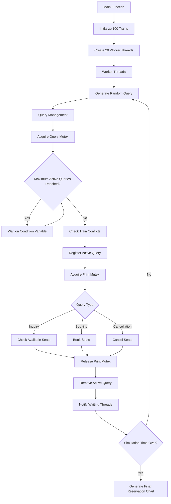

# 🚆 Railway Reservation System using Multithreading (C++)

## 📌 Overview

The **Railway Reservation System** is a collaborative C++ project that simulates a railway ticket reservation environment where multiple users perform reservation operations concurrently.

Built using the C++ Standard Thread Library, the system demonstrates core concepts of **Multithreading, Mutex Locks, Condition Variables, and Thread Synchronization** to manage concurrent user requests and shared train seat availability.

The simulation supports seat inquiries, bookings, and cancellations across multiple trains, providing a practical demonstration of concurrency management in a real-world reservation scenario.

## 🤝 Collaborative Development

This project was collaboratively developed by:

| Contributor | GitHub Profile | Repository |
|---|---|---|
| **Tuli Shruti (Shruti Guba)** | [@TuliShruti](https://github.com/TuliShruti) | [Train_Reservation_System](https://github.com/TuliShruti/Train_Reservation_System) |
| **Bharti Upkar** | [@bhartiupkar](https://github.com/bhartiupkar) | [Train_Reservation_system](https://github.com/bhartiupkar/Train_Reservation_system) |

Both contributors collaborated on the development and implementation of the railway reservation system.

## ✨ Key Features

- **Multithreaded Execution:** Creates multiple worker threads to simulate simultaneous users.
- **Seat Inquiry:** Allows users to check available seats on a randomly selected train.
- **Seat Booking:** Supports booking between 5 and 10 seats, subject to availability.
- **Booking Cancellation:** Allows users to cancel previously booked seats.
- **Thread Synchronization:** Uses mutex locks to coordinate access to shared resources.
- **Condition Variables:** Controls thread execution when query limits or conflicting operations are encountered.
- **Concurrent Query Management:** Supports up to 5 registered active queries.
- **Final Reservation Chart:** Displays the remaining seat availability across all trains after execution.

## 🏗️ System Architecture

The system follows a multithreaded worker-based architecture in which each worker thread independently generates and processes reservation requests.

### Architecture Diagram



### Workflow Explanation

1. The main function initializes 100 trains, each with 500 seats.
2. It creates 20 worker threads representing independent users.
3. Each worker generates a random train number and reservation request.
4. The query management mechanism checks the active query limit and train-level conflicts.
5. Valid queries are registered in the active query list.
6. Depending on the query type, the system performs an inquiry, booking, or cancellation.
7. After processing, the query is removed from the active list and waiting threads are notified.
8. The simulation terminates after one minute, and the final reservation chart is displayed.

## ⚙️ Technologies & Concepts

| Technology / Concept | Purpose |
|---|---|
| C++ | Core programming language |
| Standard Thread Library | Creating and managing worker threads |
| Mutex | Protecting critical sections |
| Condition Variable | Coordinating waiting and executing threads |
| Chrono Library | Managing simulation duration |
| Shared Data Structures | Maintaining train seat availability and active queries |

### Concurrency Management

The project uses the following synchronization mechanisms:

**1. Mutex Locks**

- `query_mutex`: Protects the active query list and its associated count.
- `print_mutex`: Protects console output and the reservation operation section.
- `train_num[]`: An array of per-train mutexes declared in the implementation, currently not utilized.

**2. Condition Variables**

The `query_cond` condition variable coordinates worker threads when:
- The maximum number of active queries has been reached.
- A conflicting query is detected for a particular train.

Waiting threads are notified when an active query finishes.

**3. Active Query Management**

The system maintains an array of active queries containing:

- Query type
- Train number
- Thread number

This helps identify conflicting operations involving the same train.

## 📊 System Configuration

| Parameter | Value |
|---|---:|
| Total Trains | 100 |
| Initial Capacity per Train | 500 seats |
| Maximum Worker Threads | 20 |
| Maximum Active Queries | 5 |
| Minimum Booking Size | 5 seats |
| Maximum Booking Size | 10 seats |
| Simulation Duration | 1 minute |

## 💻 Sample Execution Output

The following is an illustrative example of how the program's output may look. Actual output varies because train selection, query types, booking quantities, and execution timing are randomized.

```text
Thread 3: Inquiring 12
Thread 3: 500 seats available in 12

Thread 5: Booking seats in 24
Thread 5: booking 8 seats in 24
Thread 5: booked 8 seats in 24

Thread 7: Cancelling bookings in 24
Thread 7: cancelling 4 seats in 24
Thread 7: cancelled 4 seats in 24

Thread 2: Inquiring 24
Thread 2: 496 seats available in 24

The reservation chart at the end

    Train number    Available Seats
     0              500
     1              500
     2              500
     ...
     24             496
     ...
     99             500

Thanks for using our services!!!
```


## 📂 Project Structure

```text
Train_Reservation_System/
│
├── README.md
└── main.cpp
```

## 🚀 Getting Started

### Prerequisites

- C++ compiler (G++ recommended)
- C++11 or later
- POSIX thread support

### 1. Clone the Repository

```bash
git clone https://github.com/TuliShruti/Train_Reservation_System.git
```

### 2. Navigate to the Project Directory

```bash
cd Train_Reservation_System
```

### 3. Compile the Program

```bash
g++ -std=c++11 main.cpp -o train_reservation -pthread
```

### 4. Execute the Program

```bash
./train_reservation
```

## 🔮 Future Improvements

- Implement per-train mutex locking to allow independent train operations to execute concurrently.
- Improve condition-variable handling using predicate-based waiting to handle spurious wakeups and recheck conflicts.
- Introduce passenger details and unique booking IDs.
- Implement persistent storage for reservation records.
- Add a user-friendly interface for booking and cancellation.
- Introduce logging and transaction history.

## 🎯 Learning Outcomes

This project provided practical experience in:

- Designing multithreaded applications in C++.
- Understanding concurrency and synchronization.
- Managing shared resources across multiple threads.
- Implementing mutual exclusion using mutex locks.
- Coordinating threads using condition variables.
- Understanding race conditions and critical sections.
- Building a simulation of a real-world reservation system.

---

**Developed collaboratively by Tuli Shruti and Bharti Upkar.**

*Built using C++ with a focus on Multithreading, Concurrency, and Synchronization.*
